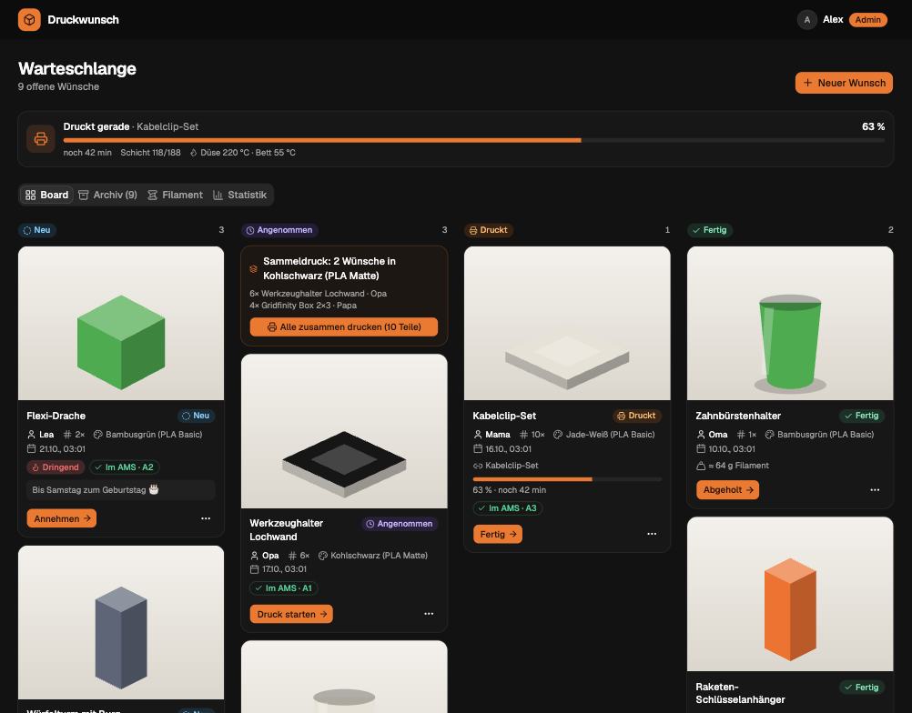
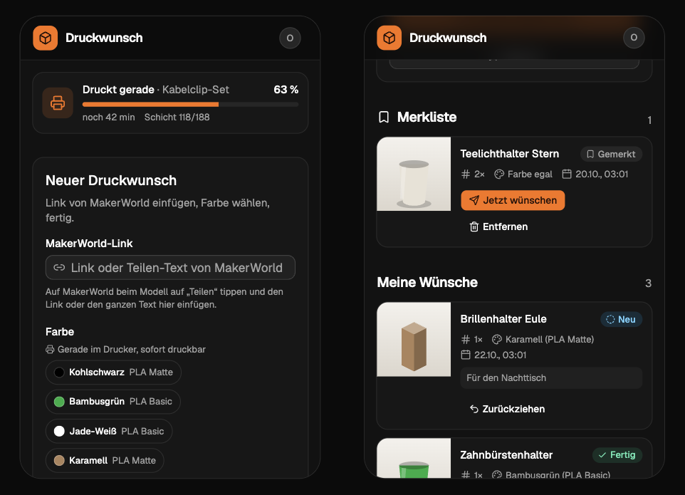
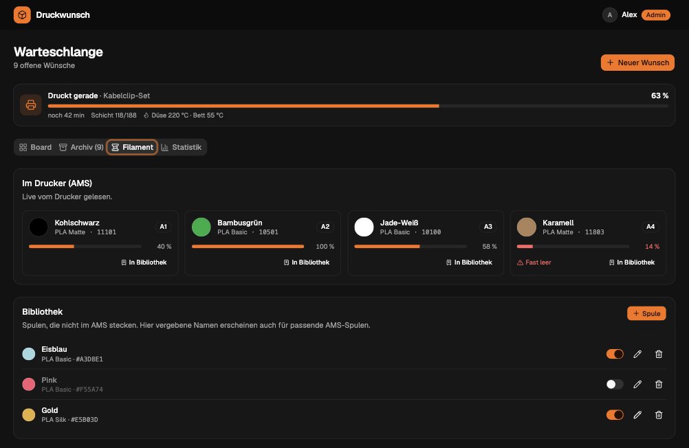
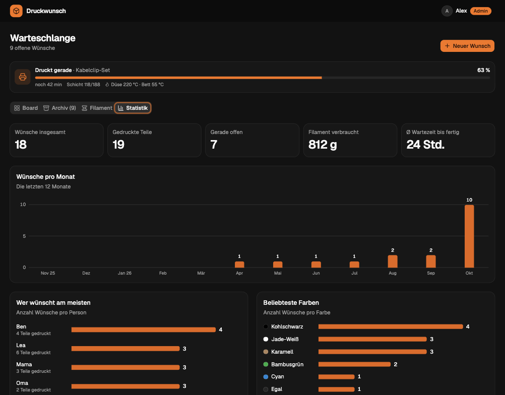
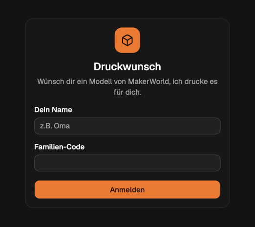

# Druckwunsch

**A self-hosted print queue for your family's 3D printing requests.**
Family members paste a [MakerWorld](https://makerworld.com) link, pick a color and send it off.
You get a tidy board, live status from your Bambu Lab printer, the spools that are loaded in your AMS,
and requests that mark themselves as done when the print finishes.

*Druckwunsch* is German for "print request". The user interface is currently **German only**.



## Features

**For your family**
- Paste a MakerWorld link (or the whole share text from the app). The title is filled in automatically when possible.
- Pick a color from the spools that are **actually loaded in the printer** or from your filament library.
- See the status of every request and live progress while it is printing.
- Keep a **wish list** for later and withdraw requests that haven't been accepted yet.
- Works great on phones, light and dark mode.

**For you (admin)**
- Kanban board: *new → accepted → printing → done → collected*, plus an archive.
- **Bambu Lab integration over LAN (MQTT):** live progress, remaining time, layers and temperatures.
- **Automatic completion:** requests linked to a print are marked done when the printer finishes.
- **AMS overview** with official Bambu color names (e.g. *Bambusgrün · 10501*) and remaining filament.
- **Color check** on every card: *in AMS · A2* or *swap spool*.
- **Batch printing** suggestions for requests that share a color.
- **Filament library** with search in the official Bambu Lab color catalog (318 filaments), by name or the
  5-digit code on the label, and barcode scanning in supporting browsers.
- **Filament usage** per print, estimated from the drop in AMS remaining amount.
- Priorities and manual ordering, statistics with requests per month, top requesters and colors.

<table>
  <tr>
    <td width="50%"></td>
    <td width="50%"></td>
  </tr>
  <tr>
    <td></td>
    <td></td>
  </tr>
</table>

## Quick start (Docker)

You need Docker with the Compose plugin. Images are published for `linux/amd64` and `linux/arm64`
(Raspberry Pi 4/5 with a 64-bit OS).

```bash
mkdir druckwunsch && cd druckwunsch
curl -fsSLO https://raw.githubusercontent.com/luka-lta/druckwunsch/main/compose.yaml
curl -fsSL https://raw.githubusercontent.com/luka-lta/druckwunsch/main/.env.example -o .env
nano .env                 # set FAMILY_CODE and ADMIN_CODE, optionally your printer
docker compose up -d
```

Open `http://<your-server>:3000`. Sign in with any name plus the family code, or with the admin code
to manage the queue. Data is stored in the Docker volume `druckwunsch_druckwunsch-data`.

**Update:** `docker compose pull && docker compose up -d`. Database migrations run automatically on startup.

## Configuration

All settings live in `.env`:

| Variable | Default | Description |
|---|---|---|
| `FAMILY_CODE` | *required* | Code your family signs in with (min. 6 characters) |
| `ADMIN_CODE` | *required* | Admin code, must differ from `FAMILY_CODE` |
| `PORT` | `3000` | HTTP port inside the container |
| `DATA_DIR` | `./data` | Where the SQLite database and catalog cache are stored (`/app/data` in Docker) |
| `COOKIE_SECURE` | `false` | Set to `true` when served over HTTPS |
| `CLIENT_IP_HEADER` | *empty* | Header with the real client IP behind a reverse proxy, see below |
| `PRINTER_HOST` | *empty* | IP address of your Bambu Lab printer |
| `PRINTER_SERIAL` | *empty* | Printer serial number |
| `PRINTER_ACCESS_CODE` | *empty* | LAN access code shown on the printer |
| `EXPO_ACCESS_TOKEN` | *empty* | Only needed for push notifications if the mobile app's Expo project uses enhanced push security |

Without the three `PRINTER_*` values, everything works except the printer and AMS features.

## Connecting a Bambu Lab printer

Druckwunsch connects to the printer's local MQTT broker (port 8883). It only **reads** status and never
sends print commands. No Bambu account or cloud access is needed.

1. Make sure the printer and the server are on the same network.
2. Take the **IP address** and **access code** from the printer's network or LAN settings.
3. Take the **serial number** from the printer's device info. It is also the common name of the printer's
   TLS certificate:
   ```bash
   echo | openssl s_client -connect <printer-ip>:8883 2>/dev/null | openssl x509 -noout -subject
   ```
4. Put all three into `.env` and restart the container. The log shows `Drucker-Anbindung an <ip>` and the board
   shows a printer card.

Tested with a **Bambu Lab P2S** with AMS. On that printer, Developer Mode was not required for reading
the status. Other models that speak the same LAN protocol (X1, P1, A1 series) should work but are untested.
Feedback is welcome.

### How requests are completed automatically

When you click *Druck starten* on a card, the request is linked to the print that is currently running,
or to the next one that starts. When that print finishes, all linked requests become *done*, and the
filament used (from the drop in AMS remaining percentage × spool weight, about ±10 g) is split between them.
After a failed print they stay on *printing* and are linked to the next attempt.

## Push notifications for the mobile app

The mobile app registers each device after sign-in
(`POST /api/push-tokens`). When someone submits a new request, the server sends a push notification to all admin
devices through the [Expo push service](https://docs.expo.dev/push-notifications/overview/), which forwards it to Apple
and Google. The server needs outgoing HTTPS access to `exp.host`; no other setup is required on the server side.
Devices that no longer accept notifications are removed automatically.

## Running behind a reverse proxy

For access from outside your home, put the app behind a reverse proxy with HTTPS, e.g.
**Nginx Proxy Manager**, Caddy, Traefik or a **Cloudflare Tunnel**, pointing to port 3000. Then set:

```bash
COOKIE_SECURE=true
CLIENT_IP_HEADER=x-real-ip        # Nginx Proxy Manager; Cloudflare Tunnel: cf-connecting-ip
```

`CLIENT_IP_HEADER` makes the login lockout (10 failed attempts → 15 minutes) apply per visitor. Without it,
all requests appear to come from the proxy, so one person guessing codes would lock out everyone. Only set
it if the container is reachable **exclusively** through the proxy, otherwise the header can be spoofed.

Do not expose port 3000 directly to the internet.

## Backups

Everything (requests, users, filament library, print history) is in a single SQLite file:

```bash
docker run --rm -v druckwunsch_druckwunsch-data:/data -v "$PWD":/backup busybox \
    cp /data/druckwunsch.sqlite /backup/druckwunsch-backup.sqlite
```

## Try it without a printer

The demo starts the app with sample data and a simulated printer with AMS. Nothing is stored.
It needs Node.js ≥ 22.13:

```bash
git clone https://github.com/luka-lta/druckwunsch.git && cd druckwunsch
npm install
npm run demo              # http://127.0.0.1:3200, codes are printed in the terminal
```

## Development

```bash
cp .env.example .env      # set codes, optionally your printer
npm install
npm run dev               # API on PORT from .env, frontend on http://localhost:5173
npm test                  # Vitest
npm run typecheck
npm run printer:probe     # test the printer connection and print the received status
```

### Releasing

Releases are driven by the version in `package.json`. On every push to `main`, the
[release workflow](.github/workflows/release.yml) checks whether a tag for that version exists. If not, it builds
and pushes the multi-arch Docker image and creates a GitHub release whose notes list the commits since the
previous release, grouped by [Conventional Commits](https://www.conventionalcommits.org) type.

```bash
npm version minor --no-git-tag-version   # or patch / major
git commit -am "chore(release): 0.5.0" && git push
```

Pushes without a version bump only run the checks. Pull requests run typecheck, tests and build.

**Stack:** [Hono](https://hono.dev) on Node.js · SQLite via the built-in `node:sqlite` (no native modules)
· [MQTT.js](https://github.com/mqttjs/MQTT.js) · React 19 · Vite · Tailwind CSS 4 · [shadcn/ui](https://ui.shadcn.com)

```
server/          API, grouped by topic
  Auth/            sign-in with codes, sessions, rate limiting
  PrintRequest/    requests, MakerWorld links and previews
  Printer/         MQTT client, status parsing, AMS, print job tracking
  Filament/        filament library and Bambu color catalog
  Statistics/
web/             React frontend (components/ui = shadcn/ui)
shared/          API types and helpers used by both sides
scripts/         demo server, Docker build and deploy scripts
```

Code comments are written in German.

## Known limitations

- **User interface in German only.** Translations are welcome.
- **Model previews are best effort.** Title and image come from an unofficial MakerWorld endpoint that is
  sometimes blocked by Cloudflare. In that case the title is derived from the link and can be edited.
  Missing images are retried every 6 hours.
- **Names are not passwords.** Anyone with the family code can sign in under any name. This app is meant for
  a family, not for the public.
- **The printer's TLS certificate is not verified** because it is signed by Bambu Lab's own CA. The connection
  is still encrypted. Keep the printer on a trusted network.
- **Filament usage is an estimate** (the printer reports remaining filament in whole percent).
- **Barcode scanning** requires a browser with the Barcode Detection API (e.g. Chrome on Android).
  Elsewhere, type the 5-digit color code from the label.

## Acknowledgements and disclaimer

Druckwunsch is an independent project and is **not affiliated with, endorsed by or sponsored by
Bambu Lab or MakerWorld**. All product names and trademarks belong to their respective owners.

The filament color catalog comes from
[Bambu Studio](https://github.com/bambulab/BambuStudio) (AGPL-3.0). It is **not bundled** with this project.
The server downloads it at runtime from GitHub and caches it locally.

## License

[MIT](LICENSE)
